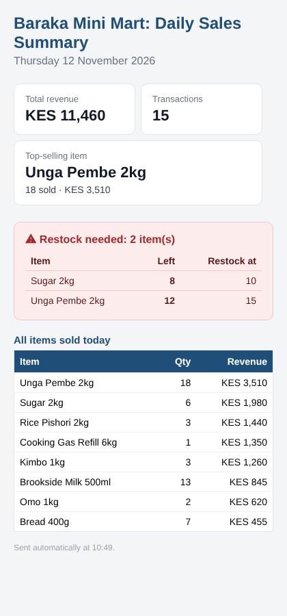

# Daily Sales Email

A Python script that emails a Nairobi shop owner a **daily sales summary every evening at 6 PM**. It reads the sales CSV his cashier updates during the day and sends a clean, phone-friendly HTML email with the four numbers he cares about:

1. **Total revenue**
2. **Number of transactions** (receipts)
3. **Top-selling item**
4. **Restock alert** for any item that has dropped below its restock level

AI Masterclass 2, Week 5, Day 23: email and notification automation.



## Pricing

**One-off build fee: KES 12,000**, plus an **optional monthly retainer of KES 1,500**.

I'd charge **one-off** for the build because the shop owner pays for a working result: the script set up on the shop's computer, his items and restock levels entered, Gmail connected, and the 6 PM email scheduled and confirmed arriving. Once it works, it keeps working with no running costs (Gmail is free and nothing is hosted).

The **retainer is optional**, for owners who want me on call. It covers adding new items or changing restock levels, fixing it if the computer or Gmail settings change, adding a weekly or monthly summary, and quick support. Most small shops will take the one-off, and the retainer suits owners who'd rather not touch any files themselves.

## Files

| File | What it is |
|---|---|
| `sales.csv` | Today's sales, updated by the cashier: `time, receipt_no, item, quantity, unit_price` |
| `stock.csv` | Stock before today and the restock level for each item: `item, stock_before_today, restock_level` |
| `daily_sales_report.py` | Reads the files, calculates the metrics and sends the email |
| `run_daily_report.bat` | Used by Windows Task Scheduler to run it at 6 PM |
| `.env` | Gmail address, App Password and recipient. **Never committed** (it's in `.gitignore`). |

The sample `sales.csv` has 18 rows from 15 receipts of realistic Kenyan shop items (Unga Pembe, Kimbo, Brookside milk and so on).

## How the metrics are worked out

- **Revenue:** quantity × unit price, summed over every row.
- **Transactions:** the number of **different receipt numbers**, so one customer buying 3 items counts once.
- **Top-selling item:** the most units sold. Ties are broken by revenue.
- **Restock alert:** `stock_before_today − quantity sold today`. If that's below the item's restock level, it's flagged in red.

Rows the cashier typed wrongly (e.g. letters in the quantity) are skipped and reported, instead of crashing the script or counting wrong.

## Setup

1. **Turn on Gmail App Passwords** for the sending Gmail account:
   - Go to **myaccount.google.com → Security → 2-Step Verification** and turn it on.
   - Search for **App passwords** in your Google account, create one named "Sales report", and copy the 16-character code.
2. **Install** the one dependency:
   ```bash
   pip install -r requirements.txt
   ```
3. **Create `.env`** from the example and fill it in:
   ```bash
   cp .env.example .env
   ```
   ```
   GMAIL_ADDRESS=yourshop@gmail.com
   GMAIL_APP_PASSWORD=abcd efgh ijkl mnop
   REPORT_TO=owner@example.com
   SHOP_NAME=Baraka Mini Mart
   ```

## Test before you automate

Preview the email without sending anything:
```bash
python daily_sales_report.py --preview
```
This prints the summary and saves `preview.html`. Open it in your browser to see exactly what the owner will receive.

Then send it for real and check it arrives:
```bash
python daily_sales_report.py
```

Example terminal output:
```
Baraka Mini Mart: Daily Sales Summary, Thursday 12 November 2026

Total revenue:   KES 11,460
Transactions:    15
Top-selling:     Unga Pembe 2kg (18 sold, KES 3,510)

RESTOCK NEEDED:
  - Sugar 2kg: 8 left (restock at 10)
  - Unga Pembe 2kg: 12 left (restock at 15)

Sent to owner@example.com
```

The email subject alone tells the owner the headline: **"Daily sales 12 Nov: KES 11,460, 15 sales | 2 to restock"**. Every send and every failure is recorded in `email_log.txt`.

## Schedule it for 6 PM (Windows)

Instead of keeping a Python script running all day with the `schedule` library, use **Windows Task Scheduler**. It's built in, survives restarts, and runs the script once at 6 PM:

1. Open **Task Scheduler**, then click **Create Basic Task**.
2. Name it **"Daily sales email"**, set **Daily** at **6:00 PM**.
3. Choose **Start a program** and browse to **`run_daily_report.bat`** in this folder.
4. In the task's **Properties**, tick **"Run whether user is logged on or not"** if the shop's computer is sometimes locked at 6 PM.

## Errors handled

| Problem | What happens |
|---|---|
| Wrong Gmail password (e.g. the normal password instead of an App Password) | Clear message saying an App Password is needed |
| `.env` incomplete | Lists what to add |
| No internet | "Couldn't send the email… check the internet connection" |
| `sales.csv` missing, wrong columns, or no valid rows | Plain-English message |
| A badly typed row | Skipped and reported by line number |
| `stock.csv` missing | The email still sends, without restock alerts |

## Stack

Python · csv · smtplib (Gmail SMTP with an App Password) · email (HTML + plain-text) · python-dotenv · Windows Task Scheduler
